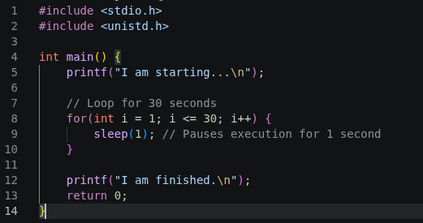
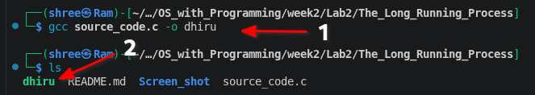
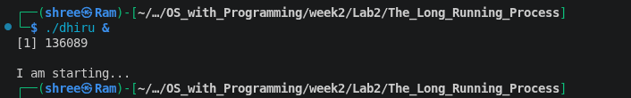
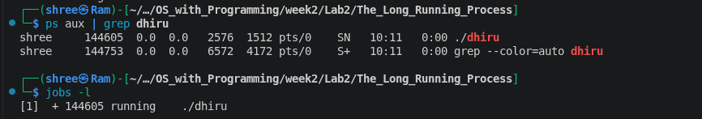
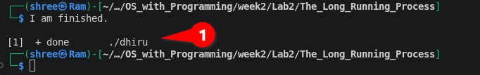

# Task 01: The Long-Running Process

## Objective

To understand how a Linux process runs in the background and how to monitor it while it is executing.

In Linux, processes can run for a long time without requiring continuous user interaction. Administrators and security professionals need to monitor active processes to understand system activity, resource usage, and process behavior.

## 1. Creating the C Program

I created a C program that runs for 30 seconds using a `for` loop and the `sleep()` function.

### Source Code

<div align='center'>
 
</div>

### Explanation

- `stdio.h` provides the `printf()` function.
- `unistd.h` provides the `sleep()` function.
- `for` loop executes 30 times.
- `sleep(1)` pauses the program for one second during each iteration.
- After approximately 30 seconds, the program prints `I am finished.` and exits.

## 2. Compiling the Program

I compiled the source code using GCC.

```bash
gcc source_code.c -o dhiru
```

The `gcc` compiler converts the C source code into an executable program named `dhiru`.
<div align='center'>

</div>

## 3. Running the Process in the Background

I executed the program using the `&` symbol.

```bash
./dhiru &
```
<div align='center'>

</div>

The `&` symbol allows the program to run in the background, returning control of the terminal to me so I can execute other commands.

## 4. Monitoring the Running Process

While the program was running, I used the `ps` command to identify the active process.

```bash
ps aux | grep dhiru

jobs -l   #to shows background running process
```
<div align='center'>

</div>

### Command Explanation

- `ps` displays information about running processes.
- `a` displays processes associated with terminals.
- `u` displays user-oriented process information.
- `x` includes processes without a controlling terminal.
- `grep dhiru` filters the output to find entries containing the name `task1`.

The output shows information such as the process owner, PID, CPU usage, memory usage, process state, and command name.

## 5. Process Verification

I verified that the process was active by checking its PID and process state.
<div align='center'>

</div>

The process remained active while the program was sleeping. After approximately 30 seconds, the program completed its execution and the process disappeared from the process list.

## Conclusion

In this practical, I learned how to compile and execute a C program, run a process in the background using `&`, and monitor active processes using `ps`.

This knowledge is useful in Linux system administration, server monitoring, troubleshooting, and cybersecurity investigations because it helps identify and understand processes running on a system.
